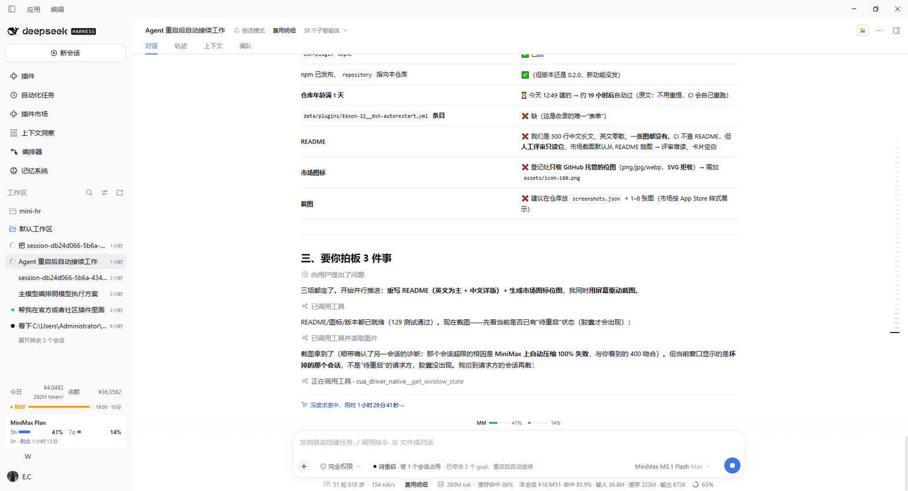
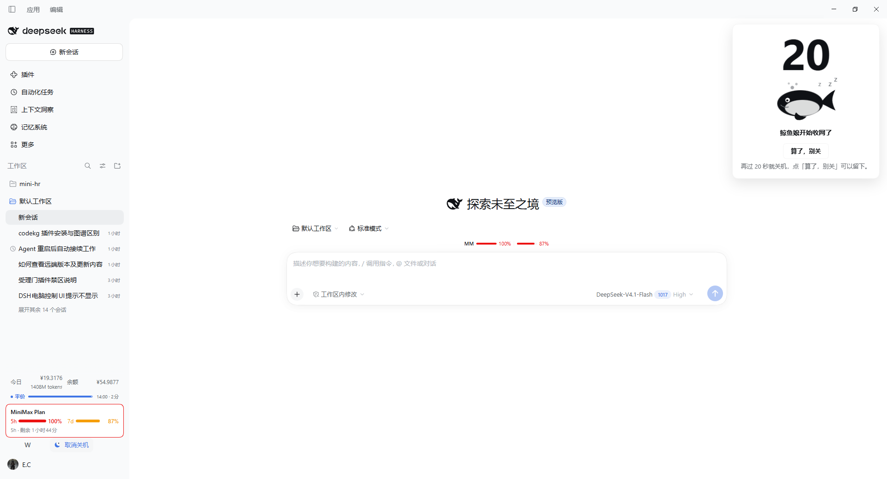
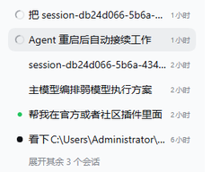

# dsh-autorestart

Restart DeepSeek Harness without losing the work that is currently running.

[](https://www.npmjs.com/package/dsh-autorestart)
[](./LICENSE)
[](https://github.com/topics/dsh-plugin)
[](https://github.com/Eason-22/dsh-autorestart)

Chinese version: [README.zh.md](docs/README.zh.md)

## What it does

`dsh-autorestart` turns a DeepSeek Harness restart into a resumable event instead of a dead end.

An agent can request a graceful restart. The plugin waits until every conversation is idle and the
host has been quiet for the settle window, then it restarts the host. Once the host is back, the
interrupted sessions resume automatically: a session that owns a durable goal gets that goal
re-armed so the goal round driver starts the next round, and a session without a goal receives one
continuation message that asks it to pick up where it left off.

Several sessions can request a restart at the same time. Those requests are coalesced into **one**
restart, and every requester is woken afterwards — not only the last one.

A goal-driven session would otherwise keep the restart waiting forever, because its goal starts the
next round as soon as the agent goes idle. The plugin therefore **disarms** such a goal before the
restart: the round that is running right now still finishes normally and nothing is lost, but no new
round starts, so the session goes idle and the restart can proceed. The goal is re-armed after the
restart and continues.

The browser shows the state: a compact "pending restart" pill on the left side of the input toolbar
and a small dot next to the session title in the sidebar. The pill's text reports how many **tasks**
are still in the way — a conversation, a subagent or a teammate counts as one task each, and the
tooltip explains that queued-but-not-started work counts too; it does not open a details panel. The
dot breathes when the restart is about to fire.

Every blocker says **what it is**: a conversation is named by its own title, and a **subagent** is
named after the conversation that created it ("Subagent of *that* conversation"). A raw session id is
never shown to the user.

Before every restart the plugin snapshots the profile, so a restart that leaves the host unable to
boot is rolled back automatically — see
[Pre-restart backup and automatic rollback](#pre-restart-backup-and-automatic-rollback).

The same "wait until everything is quiet" idea is also available as a **graceful shutdown**: a moon
button at the very bottom of the left sidebar (right next to Settings) waits for every conversation
to be idle, counts down on screen (a floating card with a huge number and a small whale) and then
switches the **real host machine** off — see [Graceful shutdown](#graceful-shutdown-收工关机).

Two safety gates protect the restart. The host checks that no conversation is busy, and the detached
helper checks the same gate over loopback immediately before it kills the process, so a turn that
starts in between is never killed.

## The whole thing in one page (ordinary users can stop here)

### Why a restart does not lose your work

The plugin turns a restart into a **resumable** event, and the order never changes:

1. **The session state is written to disk first** — what every conversation was doing and which
   goals were still armed goes into a checkpoint on disk;
2. **It queues until every conversation is idle** — whoever is still running is waited for;
3. **The process is replaced** — the old one exits, a new one comes up (the desktop app relaunches
   itself; the hosted web client is covered below);
4. **The new process checks itself** — four things: is the port up, are the routes there, did the
   plugin load, did the sessions resume;
5. **If it did not come up, it rolls back** — the pre-restart snapshot (configuration + installed
   plugins) is put back, and the verdict of that restart is written down honestly.

So "the restart lost my work" becomes "the restart carried on": you do not have to type "continue".

### Two shapes of DSH, each minding its own business

| | Desktop client | Hosted web client (`dsh web`) |
|---|---|---|
| Who brings it back | **the app itself** (it closes itself and opens itself again) | it first asks "who started me?" |
| Should a system service be installed | **no** — installing one makes it start **twice**: one more DSH at every login | only when *nobody* manages it |
| Somebody else already manages it (a supervisor script / systemd / a container / pm2 / a Windows scheduled task…) | n/a | **it only exits gracefully** and lets that supervisor bring it back (it does not start a second one) |
| It cannot tell who started it | n/a | **it does nothing and guesses no command** — "I cannot tell" beats starting a second copy next to the first |

### "Start at login": the plugin gives advice, it does not change your system

The plugin **never** changes your system configuration and **never** registers a startup entry for
you. It explains in the settings page how "start at login" works on *this* machine; the commands can
be copied, and whether you use them is your call.

| Your situation | What it recommends | Note |
|---|---|---|
| `dsh web` on Windows | start at login: a scheduled task first (no administrator rights); if this machine refuses that, a `.cmd` in the startup folder | the record runs a **real node** + the supervisor script, not the DSH client itself (that would open a second DSH at every login) |
| Linux (not WSL) | a systemd user service | that is **start after login**; **start at boot** (without a login) needs the linger enabled once |
| WSL with systemd | the same: a systemd user unit + the linger | same |
| WSL without systemd | there is no "start at login" at all. Two ways out: ① turn systemd on inside WSL (change the distribution's configuration and restart the subsystem); ② let the Windows side start the distribution with a scheduled task or a startup-folder entry (much closer to a real boot autostart) | the plugin **never** changes your distribution's configuration for you, and it never recommends a container-orchestration setup inside WSL (the orchestrator of WSL is Windows itself) |
| container / k8s | the orchestrator does it (`restart: always` and friends) | there is no "start at login" inside a container |

**"Start after login" and "start at boot" are not the same thing**: the first waits for you to log
in, the second happens when the machine comes up (and needs the linger enabled once). The plugin
writes that sentence and the matching command into the settings page.

### If DSH does not come up

Double-click `scripts/emergency-disable.cmd` in the plugin directory — it takes this plugin out
safely and keeps a backup — then open DSH again.

### What has really been tested

| How it was started | Tested on a real machine? | Evidence |
| --- | --- | --- |
| a shell supervisor script (`supervise-*.sh` and friends) | **yes** | recognised on a real machine as "somebody else manages it" → graceful exit only |
| started by hand in a terminal (foreground) | **yes** | the whole flow ran on a real machine (install, run, uninstall) |
| started in the background (`nohup` / `setsid`) | **yes** | on a real machine the re-launch command was confirmed to outlive its shell |
| WSL with systemd | **yes** | really installed and really removed |
| a Windows login task | **yes** | really created and really deleted at the system level (including the fallback into the startup folder) |
| pm2 / forever | no, unit tests only | the recognition and the behaviour are pinned by unit tests |
| container / compose | no, unit tests only | same |
| `npx` / `pnpm dlx` wrapper | no, unit tests only | same |
| started by another DSH plugin | no, unit tests only | same |
| tmux / screen / an SSH session | no, unit tests only | same |
| WSL started by a Windows-side process | no, unit tests only | same (it is recognised as "cannot tell", so nothing happens) |

**Not tested on a real machine does not mean unsupported**: those paths are pinned by unit tests. If
your environment is recognised wrongly, please send us the "startup mode + the evidence" block from
the settings page.

### Report a problem

The settings page has a "**Report a problem**" group at the bottom:

- The main button "**Copy the diagnostics and open a GitHub issue**": one click puts the diagnostics
  on the clipboard and opens a **pre-filled** issue page (title and outline) — paste the clipboard
  text into it.
- The diagnostics carry **no access token and no secrets**: only the plugin version, the platform,
  whether this is the desktop client, how the host was started (with the evidence), the supervisor,
  the restart mode, and the verdict of the last restart (with the checks that failed).
- When the browser refuses the clipboard (an insecure context, or no permission), the plugin shows
  the diagnostics in a **selectable** box and says so — a report never dies because the browser said
  no.
- No GitHub account? The same group carries the mailbox (252170229@qq.com), a "Copy the
  diagnostics" button and a matching mail link (the subject is filled in, the body asks you to
  paste).

## What it occupies in DSH

Nothing here is hidden: this is the complete list of where the plugin attaches itself, so you can see
what it adds before you install it.

| Kind | What it adds |
| --- | --- |
| Agent tools (6) | `continuum_restart`, `continuum_status`, `continuum_cancel_restart`, `continuum_park_goal`, `continuum_recover_now`, `continuum_handoff` |
| HTTP routes (7) | Under `<healthPath>` (default `/__dsh_autorestart`): `GET /health` (also `?state=1`, `?gate=1`, `?probeIndex=1`), `POST /park`, `POST /recover`, `POST /handoff`, `GET /sleep` and `POST /sleep` (the graceful shutdown — the desktop client and the hosted web client drive the very same route), `GET /announcements` and `POST /announcements` (the one-time new-feature announcement). Loopback or an authenticated browser only |
| Client slots (6) | `conversation.input.left` — the pending-restart pill (`autorestart-restart-pill`); `sidebar.session.row.leading` — the session status dot (`autorestart-restart-dot`); `conversation.input.dock` — the one-time install question (`autorestart-backup-choice`) and the one-time new-feature announcement (`autorestart-feature-announcement`); `sidebar.footer.action` — the moon button of the graceful shutdown (`autorestart-sleep-button`); `shell.overlay` — its countdown card; `settings.section` — the section "Auto-restart & shut down" in the settings page (`dsh-autorestart`) |
| System prompt | One "Restart policy" section that tells the agent how to ask for a restart and what the plugin will do |
| Harness hooks | `agent/status` (tracks which conversations are busy), `tools/pre-execute` (blocks a shell command that would kill or relaunch DSH by hand), and the boot pass that resumes interrupted sessions |
| Profile row | One bundle row, `dsh-autorestart` |
| Writes | Only under `<DSH_HOME>/storages/dsh-autorestart/` — `state.json` (checkpoint), `backups/` (pre-restart snapshots), `restart-<gen>.cmd` / `restart-<gen>-watch.ps1` (the detached helper), `last-rollback.json` (rollback report), `restart-outcome.json` (the decision of a restart the plugin judged itself), `access.json` (the access link of the running instance, mode `0600`). The only time it writes into the profile itself is a rollback, which copies that snapshot's `cordis.patch.yml`, `package.json`, `pnpm-lock.yaml` and `node_modules` back |

## Why

| Situation | Without it | With it |
| --- | --- | --- |
| An agent is running a long task and DSH is restarted or crashes | The round is lost and you have to type "continue" by hand | The new process resumes the session and injects a continuation message, so the work continues without you |
| An agent owns a durable goal (`create_goal`) that should survive a restart | The goal activation lives in the process, so after the restart it is `disarmed` and the automatic continuation stops | The plugin re-arms the goal at boot and the goal round driver starts the next round right away |
| An agent wants to install or upgrade a plugin, but a restart would cut the work short | You either wait or take the risk | Call `continuum_restart`: it waits until every agent is idle and the session continues by itself afterwards |

## Install

Current version: **0.6.2**.

From npm — the package is published under the name `dsh-autorestart`:

```sh
dsh plugin install dsh-autorestart
```

From source:

```sh
git clone https://github.com/Eason-22/dsh-autorestart.git
cd dsh-autorestart
dsh plugin --profile desktop add /absolute/path/to/dsh-autorestart
```

Inside DSH the equivalent is the `plugin_manager` tool:

```
plugin_manager install_bundle  target = <absolute path to the package>
```

Installing into a profile adds a row with the id `dsh-autorestart` to the plugin list. The host half
of the plugin takes effect immediately, but the client half (the pending restart pill and the
sidebar dot) is loaded by the browser, so refresh the page or restart DSH once after the install.

## Usage

The plugin registers six tools for the agent. All of them are also visible to you in the session,
so you can call them yourself.

| Tool | What it does | Parameters |
| --- | --- | --- |
| `continuum_restart` | Requests a graceful restart. The restart waits until every conversation is idle and the host has been quiet for `settleMs`, then the app is relaunched and this session resumes automatically. | `reason` (string, recorded in the checkpoint and the log), `resume` (boolean, default `true`), `defer_seconds` (number, extra seconds to wait before the first idle check), `parkGoals` (boolean, default `true`) — disarm a goal-driven session before the restart |
| `continuum_status` | Read-only snapshot of the lifecycle: whether a restart is pending, which sessions were checkpointed, why each blocking session blocks, the goals this plugin disarmed, the last recovery action per session, the handoffs, the state file path and the detected restart environment. | `include_sessions` (boolean, default `true`) — include the per-session checkpoint entries |
| `continuum_cancel_restart` | Withdraws a pending restart request. By default it withdraws **only the calling session's own request** (`scope: "mine"`); the other sessions that asked for the same restart keep it. `scope: "all"` cancels the request for everyone. Does nothing when no restart is pending. | `scope` (string, `mine` (default) or `all`), `reason` (string, recorded in the log) |
| `continuum_park_goal` | Disarms the goal of a session so that it no longer blocks the restart. The current round still finishes and the goal is re-armed after the restart. | `sessionId` (string, optional) — defaults to the calling session |
| `continuum_recover_now` | Re-runs the recovery immediately instead of waiting for the next restart, and reports the action and the reason for each session. | `sessionId` (string, optional) — defaults to all sessions pending recovery |
| `continuum_handoff` | Hands a session whose conversation exceeded the model context window over to a fresh session, carrying the goal objective, the recorded reasons and a bounded tail of the conversation. | `sessionId` (string, optional) — defaults to the calling session, `maxChars` (number, default `20000`) — character budget for the conversation tail |

A goal is an enhancement, not a requirement: without one, the plugin injects a single continuation
message instead of re-arming a goal.

### Cancelling a restart: only your own request, or everybody's

A restart request is **coalesced**: several sessions may ask for the same restart, and the plugin
keeps every requester in `restart.requesters` so that all of them are resumed after that one
restart. That is why "cancel" has to say **whose** request it cancels:

| Scope | What happens |
| --- | --- |
| `mine` (the default) | Only the **calling session's** request is withdrawn. The restart stays pending while other requesters remain, and `restart.bySessionId` is re-pointed at one of them. When the calling session was the **last** requester, the restart really goes away: the phase returns to `idle` and the session is released. |
| `all` | The request is cancelled for **everybody**: every requester is released and the pending restart is gone. This is "nobody restarts any more". |

Two calls are refused, and both leave the state untouched — a silent "cancel everything" is never
the fallback:

- the calling session is unknown (the tool was called without a session) → refused;
- the calling session did **not** ask for the pending restart → refused.

The tool reports what happened: `cancelled` (whether the restart request itself is gone),
`remainingRequesters` (how many sessions still wait for it), `scope` and `phase`.

```json
{ "ok": true, "cancelled": false, "scope": "mine", "remainingRequesters": 1, "sessionId": "sess-a", "phase": "deferred" }
```

### The capsule: click it for the details and for the way out

The capsule in the composer row is 22px high and ONE line wide, so it carries numbers only
(`待重启 · 已等 16 分钟 · 3 项任务在跑`) — never a name and never a hint. Clicking it (or pressing
Enter/Space on it) opens a small panel above it:

- how many tasks the restart is waiting for;
- how many OTHER sessions wait for the same restart;
- one button: **Cancel my restart**.

The button opens a confirmation (no timeout, nothing counts down): *Cancel your restart?* — and what
cancelling means right now (only you, or you while the others still get their restart). Only the
confirmation sends the request; `Esc`, a click outside the panel or **Never mind** closes it without
doing anything.

The request withdraws ONLY this session's restart request (`POST /__dsh_autorestart/cancel` with
`{ "sessionId": "…", "scope": "mine" }`): the other sessions keep theirs, and the restart still
happens for them. There is no "cancel everybody" in the panel — that stays an explicit tool call
(`continuum_cancel_restart` with `scope: "all"`).

## Configuration

Every key has a default, written in the `insert` row of `cordis.patch.yml`. To override a key, add
an `- id: dsh-autorestart` row with the same key to the `cordis.patch.yml` of the profile at
`~/.dsh/profiles/<profile>/cordis.patch.yml` (it replaces the whole config, it is not merged). The
plugin also exports a real schemastery `Config` schema, so the keys, their types and their defaults
show up in the Plugin Manager and in the config editor.

| Key | Default | Meaning |
| --- | --- | --- |
| `enabled` | `true` | Turns the whole plugin off. |
| `stateFile` | `''` | Path of the checkpoint file. Empty means `<DSH_HOME>/storages/dsh-autorestart/state.json`. |
| `resumeOnBoot` | `true` | Whether interrupted sessions are resumed automatically at boot. |
| `recoveryDelayMs` | `6000` | How long to wait after boot before resuming, so the session store and the model are ready. |
| `maxSessions` | `4` | Maximum number of sessions resumed per boot. |
| `maxResumeAttempts` | `2` | Maximum resume attempts per session, counted across boots, so a bad session cannot loop forever. |
| `deferPollMs` | `3000` | Poll interval while waiting for the conversations to go idle. |
| `deferSoftMs` | `300000` | Soft deadline: warn when the conversations are still busy after this long. |
| `deferHardMs` | `900000` | Hard deadline: warn after this long. The restart is only forced when `forceRestartWhenBusy` is enabled. |
| `deferPolicy` | `auto` | `auto` = after the hard deadline, follow `forceRestartWhenBusy` (by default keep waiting). `wait` = wait forever. |
| `forceRestartWhenBusy` | `false` | Whether a restart may be forced while a conversation is still running. The default `false` never interrupts a session: the plugin waits until the other conversations finish. |
| `restartMode` | `app` | `app` = restart the DeepSeek Harness desktop app. `command` = run `restartCommand`. |
| `restartCommand` | `''` | Custom restart command. Supports the `{pid}`, `{ppid}` and `{app}` placeholders. |
| `relaunchDelaySeconds` | `2` | How long the detached helper waits before it kills the app (`ping -n 3`, roughly 2 seconds). |
| `settleMs` | `2000` | Quiet window in milliseconds: the host must stay silent this long after the last conversation activity before a restart may start. |
| `restartGraceMs` | `0` | The **restart reserve** in milliseconds: how long the host waits after the last conversation finished before it is really RESTARTED — a dropdown: `0` / `5` / `10` / `20` / `30` / `60` seconds. `0` means "no extra wait". A restart is a daily operation, so the default is none. The settings page calls it *Wait before the restart*. |
| `sleepCountdownSeconds` | `20` | How many seconds the graceful shutdown counts down before the machine goes down — a dropdown: `0` / `10` / `20` / `30` / `60` seconds. `0` means "switch off right away" (still waiting for the conversations to be idle). **This visible countdown IS the wait before the machine goes off** — the shutdown has no second, invisible reserve. The settings page calls it *Shutdown countdown seconds*. |
| `queuedGraceMs` | `60000` | Upper bound in milliseconds for a **queued** (unclaimed) inbox message: how long it may hold the restart back before it is treated as stuck. `0` means "no upper bound" (the behaviour before 0.6.2). A **running** conversation always blocks, under every setting. |
| `autoReloadPage` | `true` | `dsh web`: reload the page automatically when the host boot token changes. |
| `blockManualRestart` | `true` | Hard-block an agent that tries to kill or restart DSH with a shell command, and point it at `continuum_restart` instead. |
| `healthPath` | `/__dsh_autorestart/health` | Health check route. Returns the boot id, the pid, the phase and the self-check flags. |
| `continuationText` | `''` | Overrides the default continuation prompt text. |
| `backupOnRestart` | `true` | Snapshot the profile before every restart, so a restart that leaves the host unable to boot can be rolled back. |
| `backupIncludePlugins` | `true` | Include the installed plugin tree in that snapshot (about 117 MB here, ~3 s). `false` keeps only the configuration files. |
| `maxBackups` | `2` | How many snapshots are kept; older ones are deleted when a new one is written. |
| `rollbackTimeoutMs` | `90000` | How long the detached watcher waits for the new host before it restores the snapshot. |
| `restartCommandTimeoutMs` | `30000` | How long the restart command may run before the plugin stops waiting for it. A command that starts the host in the foreground never returns — that is reported as "still running", not as a failure. |
| `rollbackCopyTimeoutMs` | `120000` | How long ONE restore step (the configuration files, then the plugin tree) may take. A restore that does not finish in time is given up and the reason is written into the rollback report. |
| `showSleepButton` | `true` | Whether the moon button of the graceful shutdown is shown at the foot of the left sidebar, next to Settings. |
| `sleepCommand` | `''` | A custom shutdown command for the graceful shutdown. Empty = the host is detected automatically; a value replaces the detected command (`cmd.exe /c …` on Windows, `/bin/sh -c …` everywhere else). |

The two waits are independent of each other, and both default to two seconds:

- `settleMs` (`2000` ms) is the quiet window after the last conversation activity during which the
  host has to stay silent before a restart is allowed to start.
- `relaunchDelaySeconds` (`2` seconds) is how long the detached helper waits before it kills the app.

Both can be overridden separately in the profile config. A larger `settleMs` is the more
conservative choice, because it is less likely to cut a session short that has just started.

### Why the host waits a few more seconds after the work is done

**The blind spot.** This plugin can only see the **DSH agents**: it knows whether a conversation is
running, whether it has queued inbox work, and when the last of them went idle. It cannot see the
work other plugins queue with a timer of their own — a memory plugin that writes its notes a few
seconds after the conversation ended, a summary, an MCP callback, a log flush. That work is
invisible here, so "every agent is idle" does not mean "nothing is happening any more".

**One reserve window, for the restart.** A restart has no countdown of its own: the host restarts
as soon as the conversations are done. `restartGraceMs` is the extra wait that leaves room for the
delayed work of the other plugins — and it is the **only** such window:

| Window | Governs | Default | Offered |
| --- | --- | --- | --- |
| `restartGraceMs` | the **restart** | `0` (no extra wait) | `0` / `5` / `10` / `20` / `30` / `60` seconds |
| `sleepCountdownSeconds` | the **shutdown** (visible!) | `20` (twenty seconds) | `0` / `10` / `20` / `30` / `60` seconds |

- **The restart gate waits `max(settleMs, restartGraceMs)`** of quiet. With the default (`0`) the
  gate waits for the settle window alone — a restart happens as soon as the conversations are done.
- **The graceful shutdown has no invisible reserve.** Its **visible countdown** is the wait before
  the machine goes off: the seconds are on the screen, the user can watch them and cancel them.
  A second, hidden window next to it would only say the same thing twice — so there is none. The
  shutdown starts counting down as soon as every conversation is idle.
- **New activity restarts the timer.** If a conversation starts working again while the host is
  waiting, the reserve starts over — the wait always follows the last activity.
- **Where to change them.** Settings → Auto-restart & shut down, in two titled groups:
  *Restart settings* (the wait before the restart, the two backup switches) and *Shutdown settings*
  (the countdown of the shutdown). The status interfaces report the restart reserve:
  `GET /health?state=1`, `GET /health?gate=1` and `continuum_status` carry `graceMs` (the restart
  reserve) and `effectiveSettleMs` (the window the gate really uses); `GET /sleep` carries
  `restartGraceMs` and `countdownSeconds` (the countdown that is really running). All of them carry
  `quietForMs` (how long the host has actually been quiet).

### Why a queued message cannot block the restart for ever

**The deadlock.** A conversation whose inbox holds a message nobody claimed yet counts as "busy"
for the restart gate. That is right while the message is about to be picked up — the agent claims
it within a second or two — but it is a deadlock when nobody ever claims it. The real case was a
fresh, empty conversation in the UI with one unclaimed message in its inbox: the gate stayed
closed, the hard deadline only logged a warning, and the restart never happened.

**The upper bound.** `queuedGraceMs` (default **60000** ms) is how long an unclaimed message may
hold the restart back:

- **A message claimed inside the window still blocks.** The normal case is unchanged: the agent
  picks the message up and the restart waits for it.
- **A message that is still unclaimed after the window is stuck.** It stops blocking the restart,
  and the log names the session that holds the queue (`the queued message of session <id> has been
  waiting 61s and nobody claimed it; it no longer blocks the restart`). The restart goes on.
- **A running conversation always blocks — under every setting.** The bound only ever judges
  *queued* work; a live turn is never relaxed, and no configuration can make the plugin kill one.
- **The timer follows the work.** A session that starts working drops its queue timer, and a new
  queue counts from zero again.
- **`0` means "as before".** With `queuedGraceMs: 0` an unclaimed message blocks the restart for
  ever, exactly like it did before this bound existed.
- **Where to look:** `GET /health?state=1`, `GET /health?gate=1` and `continuum_status` all report
  `queuedGraceMs`.

### What you see while the restart waits a long time

When the hard deadline (`deferHardMs`) is over and a conversation is still running, the plugin does
not pretend that everything is fine — and it does not give up either:

- **The request is kept.** The pending restart stays pending, the requester stays checkpointed, and
  the restart fires as soon as the gate is quiet again. Nothing is cancelled behind your back.
- **The wait becomes visible.** The log says it once a minute — "the restart has been waiting for
  17m; `<session>` still holds it — cancel the restart or wait for that work to finish" — and
  `GET /health?state=1` carries a `longWait` object (`since`, `reason`, `blockedBy`).
- **The bubble says it too.** The pending-restart pill shows one more line: "waiting for 17m:
  `<session>` keeps holding it" (「已等 17 分：`<会话>`一直占着」).

A conversation is never killed to make the restart happen: `forceRestartWhenBusy` stays off by
default, and this plugin never turns it on.

### What the quiet window measures

The restart gate has two layers: **no busy conversation** and **a quiet window**
(`max(settleMs, restartGraceMs)`).

The quiet window answers one question: *how long ago did the last real work happen?* It is measured
from the LATER of two markers:

- **the last real activity signal** — a turn that started or ended (`agent/status`), a message that
  was queued (`agent/inbox/inserted`), or a session event that says work happened (a message, a tool,
  a turn);
- **the last moment a conversation was seen working** — a running turn or a queued message
  (`busyAgents()`).

**A routine session event is not activity.** The host emits session events every two to three seconds
while the interface polls and synchronises (a title, a projection, a context request, a job that
settled). Counting those as activity reset the quiet window every couple of seconds, so a window
longer than the event interval could never fill: the restart never fired, however long the user
waited. That is why a grace window of ten seconds used to make the restart impossible.

The rule is one-sided: **an event whose type cannot be read is not activity.** When in doubt the
plugin restarts a little early rather than never.

**A running conversation always blocks.** The quiet window only decides *when* the restart may fire;
the busy check is the hard guarantee, and it is never relaxed by any setting.

**Where to look when the restart does not happen.** The status interfaces report the reason of the
gate next to the blockers (`GET /health?state=1` carries `reason`: `conversation-active` when a
conversation blocks, `settling` when only the quiet window is not full yet, `quiet` when it may go),
and the pending restart writes one diagnostic line into the log per minute:

```
restart gate: action=wait reason=agents-busy-within-soft-window busyCount=1 quietForMs=1432 effectiveSettleMs=10000
```

`action` is what the restart decision did (`wait`, `restart`, `long-wait`, …), `reason` why,
`busyCount` how many conversations block, `quietForMs` how long the host has been quiet, and
`effectiveSettleMs` the window it has to fill.

### Platform note

`restartMode: app` only applies to the DeepSeek Harness desktop app. A hosted `dsh web`
deployment has no desktop app to relaunch, so it must set `restartMode: command` and provide a
restart command of its own:

```yaml
- id: dsh-autorestart
  config:
    restartMode: command
    restartCommand: systemctl --user restart dsh-web
```

Remember that this replaces the whole config instead of merging into it.

## Pre-restart backup and automatic rollback

A restart is only safe if the host comes back. Before every restart the plugin snapshots the profile
it was started from, so a restart that leaves the host unable to boot can be undone automatically.

- **What is backed up:** `cordis.patch.yml`, `package.json` and `pnpm-lock.yaml`, plus — unless
  `backupIncludePlugins` is turned off — the installed plugin tree (`node_modules`). Snapshots live in
  `<storage>/dsh-autorestart/backups/<timestamp>/` with a `manifest.json` next to them. On a profile
  like this one the full snapshot measures about 117 MB and takes under three seconds.
- **How many are kept:** the newest `maxBackups` snapshots (default `2`); older ones are deleted when
  a new one is written.
- **How a failed boot is detected:** a small watcher runs **outside** the host process (so it survives
  the host being killed). It waits for the **new** instance and probes **its** health route for
  `rollbackTimeoutMs` (default `90000`). The new instance publishes its own port and its own boot id
  in `<storage>/dsh-autorestart/access.json`, so the watcher never mistakes the old instance (or the
  old port) for the new one. A healthy answer ends the watch and nothing is touched.
- **What happens when the host never answers:** the watcher copies the snapshot back over the profile
  (configuration files, and the plugin tree when the snapshot holds one) and writes
  `last-rollback.json` next to the checkpoint — including the tail of the newest crash log written
  *after* this restart and the reason the restore failed, if it did. It does **not** start a second
  copy of the host: the instance that was launched is left alone, so there is never a second window
  or a second web server.
- **The hosted mode has the same safety net.** With `restartMode: command` the restart command
  usually kills the very process the plugin runs in, so the plugin cannot confirm anything itself.
  The watcher is therefore started **before** the command runs, and it is the one that decides
  whether the new instance came up.
- **The command is judged, not assumed.** A restart command that cannot be started, or that exits
  with an error, is reported as a failure (with its exit code and output) and the snapshot is
  restored — it is never reported as a successful restart.
- **How you learn about it:** the next boot reports it. `continuum_status` gains a `lastRollback`
  object (`at`, `waitedMs`, `rolledBack`, `reason`, `backupDir`, `crashLog`, `crashTail`), and the
  next restart clears the report so it is never mistaken for a fresh one.
- **Turning it off:** `backupOnRestart: false` skips the snapshot entirely (no rollback point, and no
  watcher), which is what a user who keeps their own backups may prefer. `backupIncludePlugins:
  false` keeps the snapshot but limits it to the configuration files.

The rollback is deliberately conservative: it only runs when the relaunched host never answers its
own health route. A slow start inside `rollbackTimeoutMs` is never treated as a failure, and a
healthy host is never touched. The restore itself is bounded as well: every copy step gives up after
`rollbackCopyTimeoutMs` (default `120000`) and says so in the report.

### The access link after a restart

The boot token of `dsh web` is created **per process**, so the link the browser holds answers `401`
after a restart — the user would be locked out of their own interface. The plugin therefore writes
the access link of the running instance into `<storage>/dsh-autorestart/access.json` (mode `0600`:
the file holds a secret), and reports it in `continuum_status` and in the log. The browser half
follows that link when the one it holds is stale, so the session comes back on its own.

### Start at login: the supervisor of this plugin

A hosted host (`dsh web`) that was started by hand does not come back when it dies — and a restart
that nobody brings back is a restart the user has to do themselves. The plugin can install a
**supervisor**: a small standalone process that starts the host, watches it, and starts it again when
it is gone.

- **It is a separate process.** The plugin lives inside the host, so it can never be the thing that
  brings the host back. The supervisor is a zero-dependency Node script (`supervisor/supervisor.js`,
  shipped with the package) that the plugin copies into `<storage>/dsh-autorestart/supervisor/` when
  it is installed.
- **What it does:** start the host with the command from `supervisor.json`, wait for it to exit, back
  off (1 s → 30 s; the delay is only reset after a start that actually worked) and start it again.
  When the host does not come back at all, the snapshot of the last restart is restored.
- **How it is registered (no administrator rights):**
  - **Windows:** a scheduled task `dsh-autorestart-web` (`/SC ONLOGON /RL LIMITED`). If the machine
    forbids ordinary users from creating scheduled tasks, the plugin falls back to a `.cmd` in the
    startup folder (same zero rights, same "at login" semantics).
  - **Linux / WSL:** a systemd **user** unit
    (`~/.config/systemd/user/dsh-autorestart-web.service`). A machine without a service manager (a
    container, a WSL without systemd) has no "at login" at all — there the plugin says so and leaves
    the start command to the user.
- **The guide of every platform.** "Start at login" means something different everywhere, so the
  plugin hands out one piece of advice per platform (the settings page shows it, with the commands
  you can copy):

  | platform | what the plugin does |
  |---|---|
  | **Windows** | a scheduled task (`/SC ONLOGON /RL LIMITED`, no administrator); when the machine refuses it, a `.cmd` in the startup folder. The command names a **real node** + `supervisor.js` — never the application executable. |
  | **Linux** | a systemd **user** service — plus the `loginctl enable-linger <user>` hint, because without the linger it only starts *after* a login, not at boot. |
  | **WSL with systemd** | the same user unit, plus the linger hint. |
  | **WSL without systemd** | no "at login" at all: two ways out — ① turn systemd on inside WSL (`/etc/wsl.conf` → `[boot] systemd=true` + `wsl --shutdown`; **a system configuration change**) or ② let Windows start the distribution (`wsl.exe -d <distro> -e <command>`; **needs a Windows-side action, but it is much closer to a real boot autostart**). Inside WSL the plugin **never** recommends a container-orchestration setup — the orchestrator of WSL is Windows. |
  | **container / k8s** | no promise at all: the orchestrator brings it back (`restart: always`). |
  | **unknown** | nothing is installed and nothing is guessed: the plugin says why and asks the user to choose. |

  A host that is only **guessed** to be WSL (the mounted Windows drive is the only evidence) gets no
  automatic anything: the plugin says "not sure, pick one yourself" and changes nothing.
- **It is idempotent:** installing twice leaves exactly ONE record (the task/unit name is fixed, the
  task is created with `/F`, and the daemon takes an exclusive lock — two supervisors are impossible).
- **A failed installation leaves nothing behind:** when a step fails half way, the unit (or the task)
  that was already written is taken away again and the rollback is reported in the step list — a
  half-installed supervisor would start a stale one at the next login.
- **The program is never repeated:** a step carries the program in `file` and the arguments in `args`,
  so the record runs `systemctl --user enable --now …` and never `systemctl systemctl …` (which every
  systemd answers with "Unknown command verb systemctl").
- **It is reversible:** the previous `restartMode` / `restartCommand` are saved before anything
  changes and put back by the uninstall. The settings page has one button for it ("Settings →
  Auto-restart & shut down → Start at login"), and the manual way out is printed in the card and in
  the log. When a step of the uninstall fails, the pending cleanup is written down instead of being
  dropped silently — but only when something is really left, and it lives next to the supervisor
  directory (`<stateDir>/UNINSTALL-PENDING.json`), so writing it cannot bring that directory back.
- **The first-run card:** a hosted host is asked ONCE whether the supervisor may be installed. The
  card says what it would change, which rights it needs, and how to remove it again. Choosing "keep
  the way I start it" changes nothing — the plugin only records that a supervisor of your own is
  already there (so it never installs a second one).

The desktop app is **not** asked: it brings itself back up on its own (`restartMode: app`), so the
question would be noise there. It is also **refused** the installation itself — a login record that
starts the supervisor would start the Electron client, and that would open a **second** copy of the
app at every login. `plan` / `install` answer `ok: false` with `error: "desktop-manages-itself"` and
an empty step list there, and the settings page shows `mode: "app"` (`restartCapable: true`) instead
of the scary "restart not available".

The record that starts the supervisor always names a **real Node interpreter**: the process itself
when it is node, otherwise the runtime that ships with the installation
(`resources/runtime/primary-runtime/dependencies/node/bin/node.exe`), otherwise the `node` of the
PATH. The application executable is never used as a stand-in for node, and when no interpreter is
found the installation is refused with the reason.

### How this host was started (the startup matrix)

A hosted web host can be started in a dozen ways, and the plugin has to behave correctly in every
one of them. The classification is a **pure function** (`lib/startup-mode.js`): it takes the parent
chain, the environment markers, the container markers and the platform, and answers
`{ mode, kind, evidence, selfReplay, canInstallSupervisor, suggestion }`.

| How it was started | `mode` | What the plugin does |
|---|---|---|
| a plain terminal (`dsh web`) | `bare` | the supervisor of this plugin MAY be installed; otherwise the derived command (after your confirmation) |
| `nohup … &` / `setsid` | `bare` | the same — but the restart command is **detached** (`setsid nohup …`), so it does not die with the shell that started it |
| a supervisor script (`supervise-*.sh`) | `external` | graceful exit only (`selfReplay: refused`) — the script brings the host back |
| a systemd unit | `external` | graceful exit only (evidence: `INVOCATION_ID` or the parent chain) |
| pm2 / forever | `external` | graceful exit only |
| docker / compose / kubernetes | `container` | no "at login" at all: the compose fragment (`restart: always`) is the answer, and no supervisor is installed inside a container |
| a Windows scheduled task / an NSSM service | `external` | graceful exit only |
| WSL, started by a Windows process | `unknown` | nothing is written: the parent is invisible in WSL — pick the plain terminal (install your own supervisor) or write your own start command (optional) |
| `npx` / `pnpm dlx` | `bare` (usable) or `unknown` | usable when the resolved script path is in `argv[1]`; otherwise nothing is guessed |
| another DSH plugin spawned it | `external` | graceful exit only — never a second host |
| tmux / screen / an SSH session | `bare` | the command is replayed, but **detached from the session** (a graceful exit would break the session) |

**The two rules that matter more than the table:** only a `bare` host may get a self-replay command
or the supervisor of this plugin, and an `unknown` host gets `selfReplay: 'unknown'` and nothing
else — the plugin would rather say "I cannot tell" than start a second host next to the first.

The settings page shows the verdict **with its evidence** ("Started by … — ancestor:1234: systemd"),
so it is visible WHY the plugin says what it says.

### "Keep the way I start it": the derived restart command (E) and the dry run (B)

When the user keeps their own way of starting the host, the plugin can still write down a command
that starts it again — but only if it can be derived **without guessing**. A wrong command is worse
than no command: it looks like a restart and leaves the user with a dead host.

The candidate is built from what the process itself knows: `[process.execPath, ...process.execArgv,
...process.argv.slice(1)]` plus the working directory. The **priority** decides what happens next:

| Level | Situation | What is written |
|---|---|---|
| **E0** | The supervisor of this plugin started this instance | Nothing — the restart is asked of the supervisor over its control channel (the plugin writes the rollback request and lets the supervisor kill and start the host). |
| **E1** | An **external** supervisor is in charge (systemd, a user script, pm2) | **Not** a self-replay command: `restartCommand` becomes a graceful exit (`kill -TERM <pid>` / `taskkill /PID <pid>`), because the other supervisor starts the host again. A second supervisor would fight over the port. |
| **E2** | No supervisor and no init (a container) | The command is handed out together with a compose fragment (`restart: always`); no automatic start is promised. |
| **E3** | No supervisor, an init is available | The derived command — after the user confirmed the dry run. |

The **refusals** (each one has a code, and each one names the way out): the desktop app (it restarts
itself), a host without a web server, a command line that cannot be read back, an external
supervisor, a container without an init, and a port that changes on every start (the cookie of the
browser would die with it — the port has to be fixed).

The **dry run** (B) is the promise: the command, the working directory, the port and the health URL
are shown **before** anything is written. Only an explicit confirmation writes the command into the
profile configuration; the values that were in effect before are kept, so the settings page can put
them back with one click.

- The dry run: `POST /__dsh_autorestart/supervisor` with `{ "action": "dry-run" }` (or the tool
  `continuum_supervisor` with `action: "dry-run"`) — it writes nothing.
- The confirmation: `{ "action": "apply", "confirmed": true }` — without `confirmed` the Host
  answers `400 confirmation-required` and writes nothing.
- The undo: `{ "action": "revert", "confirmed": true }` — the previous `restartMode` /
  `restartCommand` are written back.

### The one-time install question

The first time the plugin is used, the composer dock shows ONE non-modal panel that asks whether the
pre-restart backup should also snapshot the installed plugin tree:

- **"Configuration + installed plugins"** — about 3 seconds and 117 MB more per restart; a plugin
  that breaks the boot can be rolled back too.
- **"Configuration only"** — instant, about 66 KB; plugin problems cannot be rolled back and need a
  manual reinstall.

Both options share the same base: the **configuration** is always backed up. The plugins are an
addition to it, never a rival of it.

- **It is asked exactly once.** The panel is rendered only while
  `localStorage['dsh-autorestart:backup-choice-v1']` is missing; picking an option records the answer and the
  panel never comes back.
- **Closing the panel counts as answering.** `×` and `Esc` write the very same "already answered" mark as
  picking an option, so that browser is never asked again — and closing keeps the default (configuration *and*
  plugins).
- **It never blocks you.** The panel is a `role="status"` block in the composer dock: the input box
  stays usable, nothing is modal, and the panel does not disappear on its own. It is keyboard
  reachable and `Esc` closes it.
- **Where the answer goes.** The host writes it into the profile configuration with the official
  `configEditor` service — the same `backupIncludePlugins` key the settings section edits, so there is
  one source of truth. If that service is unavailable the answer degrades to
  `<DSH_HOME>/storages/dsh-autorestart/install-choice.json` and a warning is logged. The same fallback
  happens in a hosted profile that declares no `dsh-autorestart` row of its own: there is no row for the
  editor to write, so the answer lands in that file instead of the profile. Declare the row (see
  *Hosted `dsh web` deployments* below) to keep the profile configuration as the single source of truth.
- **How to change your mind later:** Settings → Auto-restart & shut down → `backupIncludePlugins`.
  `continuum_status` always reports the value that is in effect right now
  (`backupIncludePlugins: true | false`).

### The one-time new-feature announcement (upgrades)

**The gap it closes.** The install question above is asked exactly once — on the *first* install. An
installation that already existed therefore never hears of a feature that was added later: for an
upgrade the new moon button would simply not exist. Since **0.5.0** every new feature is announced
once, in the same composer dock, as a small card:

> **New feature: graceful shutdown**
> There is a new 🌙 "Shut down" button at the very bottom of the left sidebar.
> Click it → once every conversation is done it counts down **N** seconds and powers the machine off.
> To change that, go to "Settings → Auto-restart & shut down".
> **Got it**

- **Only after an upgrade.** The host compares the version of the feature with the version it has
  already shown (`seenFeatureVersions` in the checkpoint file). A fresh installation never sees the
  card: the install question already explains the features, and answering it marks the announcement
  as seen.
- **"Seen" means "not older", not "equal".** The card counts as answered as soon as the recorded
  version is **not older** than the current feature version — a record of `0.6.0` counts as seen
  while the feature itself stands at `0.5.0`. Why not equality? Because the record does not say
  *which* release the user answered on (until 0.6.0 the card carried the version of the package),
  so an equality check would tell a user who already dismissed the card that they never saw it. A
  record that is not a version at all counts as seen as well: a broken record must not make the
  card come back for ever.
- **Once per feature version, for ever.** "Got it" records the version, the card disappears at once,
  and it never comes back — not with the next restart of the host, and not with the next release of
  the plugin (a *newer version of the feature* is announced again, of course).
- **The announcement follows the FEATURE, not the release.** The version it carries is a constant in
  the source (`SLEEP_FEATURE_VERSION` in `index.js`), **not** the version of the package: a release
  never brings the card back. Until 0.6.0 the card carried the package version, and every release
  (0.5.0 → 0.6.0) brought "graceful shutdown" back to the users who had already answered it.
- **How to announce it again on purpose.** Raise `SLEEP_FEATURE_VERSION` to a version **newer** than
  the one that was recorded last: the card is then shown exactly once more. Do that **only** when
  the feature itself changed so much that the user has to hear about it again (the shutdown became a
  completely different thing, the button moved somewhere else, …). A release, a bug fix or a small
  addition must **not** touch it — that is exactly the bug this constant exists to prevent.
- **An unanswered card is not swallowed.** The card stays until it is answered, and it comes back with
  the next start of DSH.
- **The countdown is read, not written.** The seconds in the card are the ones that are really in
  effect (`sleepCountdownSeconds`), and when the moon button is switched off the card says so
  ("The button is currently switched off; you can turn it on in the settings").
- **Where the state lives.** `<DSH_HOME>/storages/dsh-autorestart/state.json`, next to the checkpoint
  of the plugin. The host serves it on `GET /announcements` (`{ ok, pending: [{ feature, version }] }`)
  and records it on `POST /announcements` (`{ feature }`). The `version` in that answer is the feature
  version — the same number that `SLEEP_FEATURE_VERSION` holds.

## Graceful shutdown (收工关机)

**What it does.** One moon button at the very bottom of the left sidebar: press it and the plugin
waits until **every** conversation is idle, the screen counts down (a huge number and a small blue
whale, one line of text per second), and then the machine is switched off. The countdown can always
be cancelled — the card has a button, and the moon button itself becomes a toggle while the shutdown
is armed. If a conversation starts working again during the countdown, the countdown goes back to
"waiting" and nothing is switched off.

### Shutdown and restart: who goes first

**The short version.** Pressing the moon button means "switch the machine off when the work is
done" — **not** "switch it off right now, whatever else is running". So:

1. **A pending restart wins.** If a restart is still on the list, the shutdown does **not** happen.
   The card says *"Waiting for the pending restart to finish before shutting down"*. The restart
   goes first, the sessions come back with it and keep working, and only then does the machine
   go off.
2. **The work keeps running after the restart.** The sessions that resume with the restart are
   running work: while any of them is busy, the shutdown waits. The machine only goes off when
   **every** session is idle again.
3. **The shutdown intent survives the restart.** You pressed the button **once**. The restart does
   not swallow that request: it is written into the checkpoint file, and the new boot picks it up
   and keeps waiting for the work. You do **not** have to press the button a second time.
4. **You can cancel at any time.** The waiting card has a *"Keep it on"* button; pressing it (or the
   moon button again) forgets the intent for good.

**Where the intent lives.** In the checkpoint file
(`<DSH_HOME>/storages/dsh-autorestart/state.json`) as `sleep: { armed, armedAt, countdownSeconds }`.
It is cleared as soon as the machine went off, when the shutdown failed, and when you cancel. A
record that cannot be read is dropped — asking once more is much better than a machine that switches
itself off for ever because of a half-written file.

**For the troubleshooting.** `GET /sleep` reports `armedAt` (when the shutdown was armed) next to
`phase`, `blockers`, `countdownSeconds` (the countdown that is really running) and
`restartGraceMs` (the restart reserve).

### Troubleshooting: the machine did not switch off

**These are the real answers of a running host** (the copy of the host is Chinese, the fields are
not):

```
POST /__dsh_autorestart/sleep {"action":"arm"}   # three conversations are working
→ phase=waiting  armed=true  remainingMs=20000   (the full value: the countdown has NOT started)
  message: 等 3 个任务收工，收工后开始倒数。

# after a restart was requested:
GET /__dsh_autorestart/sleep
→ phase=waiting  armed=true  remainingMs=20000
  message: 等这次重启完成后再关机……
  blockers: [{"sessionId":"restart-pending","kind":"restart-pending",
              "label":"待执行的重启","name":"待执行的重启"}]
```

`remainingMs` at its full value is the tell: **the countdown has not started**, so the machine is
waiting for something. Here is what it can be, and what to do about it:

1. **Some tasks are still working.** `blockers[]` lists them; look at `kind`:
   `session` is a conversation, `subagent` is a child agent of one. A subagent counts as work on
   purpose — otherwise a restart would cut it off. **What to do:** let it finish, or stop that
   conversation. The list shrinks on its own.
2. **A restart is still pending.** `kind` is `restart-pending` (`label`/`name` are
   `待执行的重启`). That is normal queueing, not a fault: the restart runs first, the sessions
   come back with it, and the countdown continues afterwards. **What to do:** nothing — wait for
   the restart. (You can also cancel the restart with `continuum_cancel_restart`.)
3. **The work just ended and the countdown has not started yet.** The shutdown has **no invisible
   reserve**: as soon as every conversation is idle the countdown starts. **What you see:**
   `phase` is `waiting` while `blockers[]` is empty and `remainingMs` is at its full value only
   while the conversations are still busy — with an empty list the countdown is already running.
   **What to do:** nothing; the countdown is on the screen and it can be cancelled there. (The
   restart has its own window — `restartGraceMs`, default none — and the two never influence each
   other.)
4. **Somebody started working during the countdown.** The countdown goes back to "waiting" and
   `remainingMs` returns to its full value. **What you see:** the message says that somebody
   started working again, and `blockers[]` lists who. **What to do:** let them finish.
5. **You want to know who it is waiting for.** `continuum_status` → `blockedBy[]` and
   `GET /sleep` → `blockers[]` are the **same data**: the first is for agents, the second for
   scripts. Each entry has `kind` (what it is), `label` (the title of the session) and `name`
   (the whole name, e.g. "the subagent of the coding session"). A session whose title could not
   be resolved reports `label: null` and an empty `name` — that is why the waiting line then
   only says "等 3 个任务收工" without a list of names.
6. **You do not want it at all.** The cancel button on the waiting card (or the moon button
   again, or `POST /sleep {"action":"cancel"}`) clears the intent for good: `armed` becomes
   `false` and `armedAt` becomes `null`.

**Where the button is.** The moon button sits at the **very bottom of the left sidebar, right next
to the Settings row** (`sidebar.footer.action`). That seat is a **root** slot, so the button is
there even when no conversation is open — on any page. When the sidebar is collapsed into its narrow
rail, the button shows its icon only (the tooltip and the accessible name still say what it does),
so the rail keeps its width.

**The countdown does not cover the interface.** The countdown is a **floating card** in the corner,
not a full-screen mask: it never dims the page, never locks the scrolling and never swallows a
click. You can keep reading the conversation, keep scrolling and keep switching conversations while
it counts down; only the card's own cancel button takes clicks. Switching a conversation or a page
does not interrupt the countdown either — the seconds come from the host, not from the view that
happens to be open.

**What gets switched off: the real host.** Not a subsystem — the whole machine:

| Host | Command |
| --- | --- |
| Windows | `shutdown.exe /s /f /t 0` |
| WSL (the DSH itself runs inside a distribution) | `/mnt/c/Windows/System32/shutdown.exe /s /f /t 0` — the Windows binary through the mounted `C:` drive, so **Windows itself** goes down. The WSL subsystem is never shut down. |
| A real Linux host | `systemctl poweroff` (fallback `shutdown -h now`) |
| macOS | `osascript -e 'tell application "System Events" to shut down'` |
| Anything else | **Nothing is executed at all.** The button stays hidden and the route reports `phase: "unsupported"`. |

A WSL host is recognised through `WSL_DISTRO_NAME`, `WSL_INTEROP`, a `/proc/version` that mentions
Microsoft, or the mounted Windows binary. The countdown belongs to the plugin, so the operating
system is asked to shut down immediately (`/t 0`) instead of counting down a second time.

**Configuration.** `showSleepButton` (default `true`) decides whether the button is shown,
`sleepCountdownSeconds` (a **dropdown**: `0` / `10` / `20` / `30` / `60` seconds, default `20`) how
long the countdown runs, and `sleepCommand` (default `''`) replaces the detected command with one of
your own — empty means "detect the host automatically". `0` means **no countdown at all**: the machine
is switched off as soon as every conversation is idle (a busy conversation still blocks it), and no
countdown card appears. A profile that still carries a value the dropdown does not offer (`15`,
`45`, …) is snapped onto the nearest offered one instead of breaking.

**One click is all it takes.** The moon button arms the shutdown: the host waits for every busy
conversation, counts down **20 seconds** in a floating card (it never covers the interface), and then
switches the machine off. Clicking the button again — or the cancel button on the card — takes it
back. Nothing else is asked of the user: no confirmation dialog, no second click.

**The desktop client and the hosted web client behave exactly the same.** There is no ticket, no
extra header and no hidden mode: `POST /__dsh_autorestart/sleep` takes nothing but the action, and
the same route serves both. A script (or an agent) can therefore drive the shutdown as well:

```bash
# arm it (the machine counts down and goes off)
curl -s -X POST http://127.0.0.1:<port>/__dsh_autorestart/sleep \
  -H 'content-type: application/json' -d '{"action":"arm"}'
# take it back
curl -s -X POST http://127.0.0.1:<port>/__dsh_autorestart/sleep \
  -H 'content-type: application/json' -d '{"action":"cancel"}'
```

**The one-time install question.** The first time the plugin is used, the composer dock asks once
more whether the button should stay. The answer is written into the profile configuration
(`showSleepButton`) through the same `configEditor` service the backup question uses, so the
settings section and the prompt always show the same value.

**The settings section.** *Settings → Auto-restart & shut down* is a section of its own in the
settings sidebar (right below the Agent presets). It is split into two titled groups — the restart
settings first, the shutdown settings after them:

- **Restart settings**
  - **Wait before the restart** (`restartGraceMs`) — the dropdown `0` / `5` / `10` / `20` / `30` /
    `60` seconds. `0` (the default) means "no extra wait": the host restarts as soon as the
    conversations are done.
  - **Backup before a restart** (`backupOnRestart`) — whether the pre-restart snapshot is taken at all.
  - **Include the installed plugins in the backup** (`backupIncludePlugins`) — whether that snapshot
    also contains the plugin directory of the profile. It is greyed out when the backup itself is off.
- **Shutdown settings**
  - **Shutdown countdown seconds** (`sleepCountdownSeconds`) — the dropdown `0` / `10` / `20` / `30` /
    `60`. `0` means "no countdown": the machine is switched off as soon as every conversation is idle.

A change is written into the profile configuration at once (through the plugin's own choice route)
and is read back from the host, so the section never shows a value the host did not take. A malformed
value is refused with a **400** and **nothing** is written.

**Trying it without switching anything off.** Set `DSH_AUTORESTART_SLEEP_DRYRUN=1` in the host
environment: the plugin then reports the command it *would* run and never runs it.

**The machine-readable state.** `GET <healthPath 前缀>/sleep` (default
`/__dsh_autorestart/sleep`) answers with the phase, the countdown and the host that is about to be
closed. A few of its fields are meant to be read by code rather than by a human: `host.kind` is the
kind of machine (`windows`, `wsl`, `linux`, `macos`, `unsupported`, or `custom` when the platform
could not be recognised but a `sleepCommand` was configured); `host.suspect` is `true` when the host
was only recognised as WSL because the Windows drive is mounted — a hint, not a proof;
`lastRun.dryRun` marks the last run as a rehearsal that switched nothing off; and
`backupOnRestart` / `backupIncludePlugins` report the effective scope of the pre-restart backup.

**The record of the last restart.** `GET <healthPath>?state=1` and the `continuum_status` tool both
report `lastRestart`: the snapshot that was taken before the restart (`snapshot.dir`,
`snapshot.stamp`, `snapshot.atLocal` — the local time, because the directory name is UTC —,
`snapshot.durationMs`, `snapshot.pruned`) and the verdict of the instance that came up
(`result` is `pending`, `ok` or `failed`, plus `verifiedAt`, `durationMs` and the four boot checks
`listener` / `routes` / `plugin` / `recovery`). A restart whose new instance never came up stays
`pending` — that is visible too. The file behind it is
`<stateDir>/last-restart-verdict.json`.

**Who starts this host.** The `supervisor` block of the same payload says `mode`
(`app` / `installed` / `external` / `unknown` / `off`), `restartCapable`, and — since a second supervisor
would fight over the port — `selfReplay` (`allowed` / `refused` / `unknown` / `n/a`) plus the `external`
evidence (`kind`, `evidence`, `commandLine`) when somebody else is in charge. On Linux the parent
chain of the host is read (`/proc/<pid>/cmdline`), so a `supervise-*.sh` script of the user is
recognised. When nobody can be identified the mode is `unknown`, never a silent "bare host": the
plugin then refuses to replay its own command. The **desktop app** is never `unknown`: it brings
itself back up, so it reports `mode: "app"` with `restartCapable: true` and `selfReplay: "n/a"`.

**When the shutdown command does not start.** The host waits for the real answer of the process. If
the command cannot start (missing binary, denied permission), the shutdown does **not** pretend it
worked: the phase goes back to `idle`, the reason is reported ("the shutdown command did not start
(…), the computer is still on, press the moon button again"), and the machine stays on. On screen
the "shutting down" card never locks the interface: after at most eight seconds it offers a button
that closes the card.

## Requirements and limits

- **Windows desktop.** `restartMode: app` restarts the DSH desktop app on Windows. Any other
  platform, and every hosted `dsh web` deployment, has to use `restartMode: command` with its own
  restart command.
- **The manual-restart guard is pattern matching, not a sandbox.** It looks at the command text for
  kill and restart verbs together with DSH process names or the pid of this host. Encoded commands,
  killing by image name, and routes around the guard — a GUI menu, an external script, a system
  reboot — are not covered. It exists to stop an agent from casually killing itself, not to contain
  a hostile command.
- **A session past the model context window cannot continue.** Once a conversation has grown beyond
  the model context window, the provider rejects every request with `invalid_request_error`, and the
  host's own compaction cannot rescue it because the compaction request needs the same oversized
  context. Hand such a session over with `continuum_handoff`; the plugin deliberately refuses to
  auto-resume it.
- **A hosted deployment must let the browser read the state route.** The pending restart pill reads
  `GET <healthPath>?state=1`. The route accepts loopback callers and requests that the host
  connection service considers authenticated browsers. A hosted deployment that blocks it will never
  show the pill.
- **The restart closes and reopens the desktop window.** It is a full app restart, not a hot reload.
- **The resumed round consumes API tokens**, exactly like typing "continue" by hand.

### Hosted `dsh web` deployments

| Deployment | `restartMode` | How the host is restarted |
| --- | --- | --- |
| DeepSeek Harness desktop app (Windows) | `app` (the default) | The host's own app restart: the old process tree is killed and the desktop app is relaunched |
| A hosted `dsh web` deployment | `command` | There is no "restart the app" in a web deployment — you must supply the command yourself |

Minimal configuration for a hosted `dsh web` (it **replaces** the whole `config` block, it is not merged):

```yaml
- id: dsh-autorestart
  config:
    restartMode: command
    restartCommand: systemctl --user restart dsh-web
```

`restartCommand` may use the placeholders `{pid}` (this host), `{ppid}` (its parent) and `{app}` (the desktop
app path).

**Without that configuration the restart fails, and it says so.** A hosted host is not the desktop app, so
the plugin has no way to relaunch it: the log gets
`no restart method available (not the desktop app and restartCommand is empty); leaving the checkpoint in place`,
the pending restart is rolled back (one retry with a backoff, then it is cancelled instead of retrying
forever), and nothing is relaunched — the checkpoint simply stays on disk, so the session is picked up again
when the host is started by hand. `continuum_status` keeps reporting the pending state until it is cancelled.

The same profile row is what the one-time install question writes into: a hosted profile that declares no
`dsh-autorestart` row has no row for the `configEditor` service to edit, so the answer falls back to
`<DSH_HOME>/storages/dsh-autorestart/install-choice.json` instead of the profile configuration. Declaring the
row keeps the profile (and therefore the settings section) as the single source of truth.

## Verify

The health route tells you whether the plugin is alive and what it has done:

```sh
curl http://127.0.0.1:<gui port>/__dsh_autorestart/health
# {"ok":true,"plugin":"dsh-autorestart","bootId":"…","pid":17884,"phase":"running",
#  "pageHeartbeat":true,"systemPrompt":true,"configSchema":true,"indexTaps":1,…}
```

`bootId` and `pid` change with every new process, so a restart is visible right away.

- `?state=1` returns the pending restart state: `pendingRestart`, `waiters`, `blockedBy`,
  `allowRestart`, `quietForMs`, `settleMs`, `parkedGoals`, `recovery` and `handoffs`.
- `?probeIndex=1` applies the page heartbeat injection to a probe HTML page, so the client half can
  be checked without an authenticated page.
- `?gate=1` returns the live idle gate verdict that the detached helper uses before it kills
  anything.
- `POST /__dsh_autorestart/park` disarms a goal, `POST /__dsh_autorestart/recover` re-runs the
  recovery immediately. Both use the same authentication rules as the health route.
- `GET /__dsh_autorestart/sleep` reports the state of the graceful shutdown, `POST
  /__dsh_autorestart/sleep` arms (`{ "action": "arm" }`) or cancels (`{ "action": "cancel" }`) it.
- Inside a session, `continuum_status` reports the same lifecycle.

The plugin ships its own test suite: **250 test cases** in `plugins/dsh-autorestart/test/`, all
green. Run it with the bundled Node, from the workspace root:

```sh
node --test "plugins/dsh-autorestart/test/*.test.mjs"
```

Node 24 treats a positional argument as a glob, so keep the quotes. The same suite also runs with
a bare `node --test` from the package directory. Passing the directory itself (`node --test
test/`) does not work: the argument is read as a glob, and a glob does not match directories.

## Screenshots








## License

MIT — see [LICENSE](./LICENSE).

## Submitting to the curated plugin list

The curated list lives in the `awesome-dsh-plugin/awesome-dsh-plugin` repository, and one pull
request that adds a single file is the whole submission: `data/plugins/<owner>__<repo>.yml`. For
this plugin that file is `data/plugins/Eason-22__dsh-autorestart.yml`:

```yaml
url: https://github.com/Eason-22/dsh-autorestart
name: Eason-22/dsh-autorestart
category: session
description:
  en: 'DeepSeek Harness plugin: restart without losing work, with an idle-aware graceful restart and automatic session resume after the host comes back.'
  zh: 'DeepSeek Harness 插件：重启不丢工作——等所有对话空闲后优雅重启，重启后自动接续被打断的会话。'
icon: https://raw.githubusercontent.com/Eason-22/dsh-autorestart/main/assets/icon-180.png
```

The list's CI checks that the repository declares a `dsh.bundle` manifest, that the repository is
at least one day old (the check re-runs by itself, so no need to resubmit), that the repository
exists and is not archived, and that a pull request adds at most three entries. Descriptions are
read as claims about the plugin and are checked against the code, so keep them factual and free of
marketing. The marketplace icon must be a GitHub-hosted raster image (png, jpg, jpeg or webp; SVG
is refused) — this repository ships `assets/icon-180.png` — and the optional `screenshots.json` next
to `package.json` lets the storefront show the images listed in `assets/`. The two READMEs of the
list are generated from the entry files; do not edit them by hand.

## AI-generated notice

This plugin was generated by an AI and has **not** been reviewed by a human. It restarts your DSH
process and writes local state files, so it can interrupt a running session. Try it in a test
profile first, evaluate the risk yourself, and only then use it in your daily profile.
